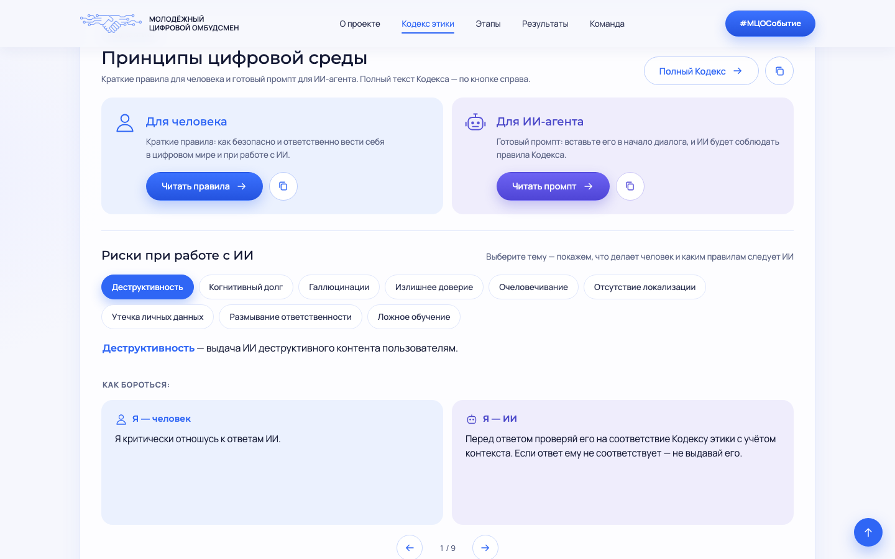
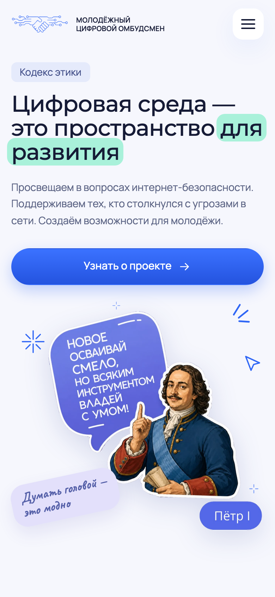

# Кодекс этики — Молодёжный цифровой омбудсмен (МЦО)

Сайт проекта «Кодекс этики» Молодёжного цифрового омбудсмена (МЦО) при поддержке РАЭК:
простые правила поведения в интернете и при работе с ИИ.

**Сайт:** <https://ethic.internet-security-school.ru/>


## Что есть на сайте

- **Кодекс этики** поведения детей и подростков в цифровой среде, полный текст и краткие правила.
- **Принципы цифровой среды:** правила для человека и готовый промпт для ИИ-агента с кнопкой копирования.
- **Риски при работе с ИИ:** 9 тем (галлюцинации, утечка личных данных, излишнее доверие и другие) в карусели с карточками «Я — человек» и «Я — ИИ».
- **Дорожная карта** проекта.
- **Стикерпак «Великие о цифре»:** карусель, скачивание в PNG и архивом.
- **Команда МЦО** и ссылки на сайт МЦО, ВКонтакте и Telegram.



## Как сделано

- Статический сайт на **HTML, CSS и JavaScript** без сборки и зависимостей.
- Вёрстка по макету из Figma, адаптивная, с бургер-меню на мобильных.
- Светлая и тёмная тема с переключателем.
- Плавная прокрутка по якорям, анимации появления, модальные окна, карусели.
- Версионирование `styles.css` и `script.js` в разметке, чтобы браузер не брал старый кэш.



## Запуск локально

```bash
python3 -m http.server 8000
# открыть http://localhost:8000
```

## Структура

```
index.html     — разметка
styles.css     — стили
script.js      — интерактив: темы, карусели, модальные окна, копирование, скачивание
assets/        — изображения и стикеры
docs/          — скриншоты для README
```
